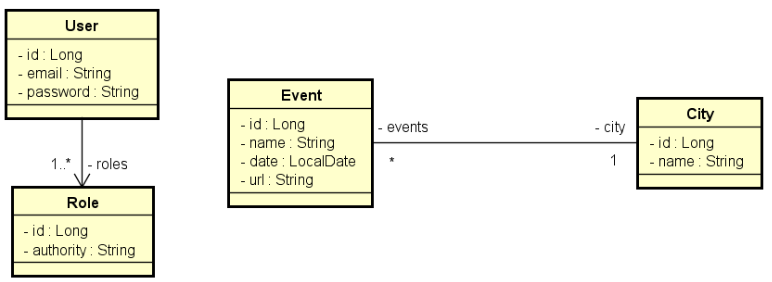

# Desafio 2 DevSuperior - TDD com Validação e Segurança
Segundo desafio do curso Java Spring Expert do Professor Nélio Alves - Dev Superior.

## Descrição do desafio:

Este é um sistema de eventos e cidades com uma relação N-1 entre eles:

Implemente as funcionalidades necessárias para que os testes do projeto passem

## Critérios de avaliação:
- [x] POST /events deve retornar 401 Unauthorized para usuário não logado
- [x] POST /events deve retornar 201 Created para CLIENT logado e dados corretos
- [x] POST /events deve retornar 201 Created para ADMIN logado e dados corretos
- [x] POST /events deve retornar 422 Unproccessable Entity para ADMIN logado e nome em branco
- [x] POST /events deve retornar 422 Unproccessable Entity para ADMIN logado e data no passado
- [x] POST /events deve retornar 422 Unproccessable Entity para ADMIN logado e cidade nula
- [x] GET /events deve retornar 200 Ok com página de recursos
- [x] POST /cities deve retornar 401 Unauthorized para usuário não logado
- [x] POST /cities deve retornar 403 Forbidden para CLIENT logado
- [x] POST /cities deve retornar 201 Created para ADMIN logado e dados corretos
- [x] POST /cities deve retornar 422 Unprocessable Entity para ADMIN logado e nome em branco
- [x] GET /cities deve retornar 200 Ok com todos recursos ordenados por nome

## Competências avaliadas:
- Desenvolvimento TDD de API Rest com Java e Spring Boot;
- Implementação de segurança com Spring Security e OAuth2;
- Controle de acesso por rotas e perfis de usuário;
- Validação de dados com Bean Validation.